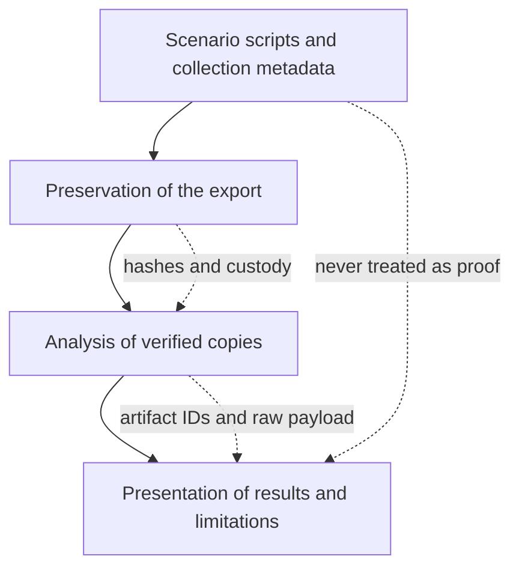
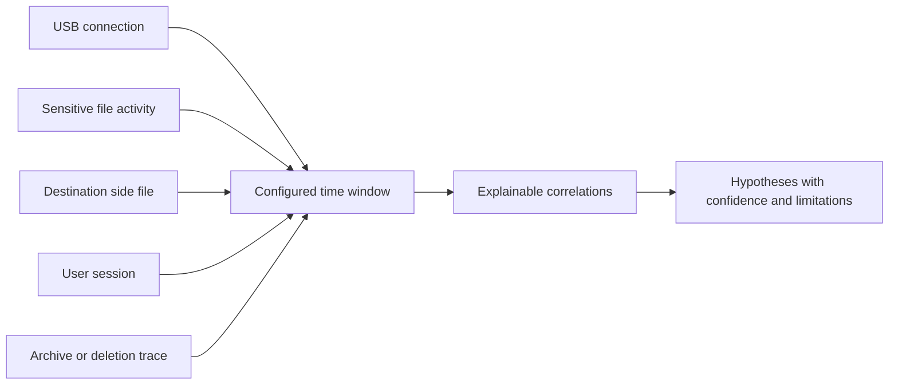

# Complete Project Handoff and Knowledge Transfer

## Project identity

**Title:** USB Insider Forensics: Detecting Data Exfiltration via Removable Media on Windows

**Repository:** https://github.com/gauravgoodreads/windows-insider-usb-forensics

**Local project folder:** `C:\Users\Gary\Desktop\CF proj`

**Local dashboard:** `http://127.0.0.1:5000`

**Case ID:** `INSIDER-USB-001`

**Fictional workstation:** `CORP-PC01`

**Fictional user:** `employee01`

**Scenario USB label:** `BACKUP_DRIVE`

**Plain-language explainer for the examiner:** https://claude.ai/artifact/GDoCq2Gd47RWTXCXSWTemL (also `docs/project-explainer.html`)

This document is the complete technical and demonstration handoff. It explains what the project does, how the parts fit together, how to run and verify it, how to collect real evidence, how to demonstrate it, and what each folder is for.

## Current state

The project is complete and needs no virtual machine.

- The automated validator passes every check and all 14 tests pass.
- The demo pipeline processes 15 artifacts into 8 correlations and 4 hypothesis decisions, and generates PDF, HTML, Markdown, JSON and CSV outputs.
- The React dashboard (shadcn/ui + ReUI) is prebuilt into `dashboard/static/app` and served by Flask, so presenting needs only Python.
- A read-only collector (`collector/collect_usb_artifacts.ps1`) exports real USB evidence from any Windows PC, including USB pen drives (USBSTOR) and external USB hard disks.
- **Both experiments were run for real** on the project laptop (LAPTOP-MKT5QBHD, user Gary) on 21 October 2026 with a Seagate Expansion external USB disk (D:) and only fictional company files. The evidence is in `evidence/real-run/` with SHA-256 manifests, and the analysis is in `data/cases/real_run.db` and `outputs/real-run/`. The real evidence reproduces the designed result: no transfer correlation for A, a HIGH-confidence possible transfer session (CORR-005) for B, H1–H3 supported, H4 partially supported, score 13. The fictional files were moved to the Recycle Bin afterwards.
- An earlier 30-day triage of the same laptop (231 artifacts) reported USB use with no sensitive transfer: a real-world false-positive check.

An earlier plan to build the scenarios inside a VirtualBox virtual machine was dropped on 21 October 2026: the host's Hyper-V/Memory Integrity made Windows 11 Setup hang repeatedly. The analysis never depended on the VM. Those scripts are archived outside the project at `C:\Users\Gary\Desktop\CF-proj-archive`.

## What the project is in very simple language

The project asks one careful question: can the traces Windows leaves behind tell an ordinary USB backup apart from someone copying sensitive company files to a USB drive?

Windows leaves many small clues. A device record may show that a USB existed. A recent-document shortcut may show that a file was opened. A file listing may show the same file on the USB. A logon record may show who was signed in. An archive or deletion trace may show additional activity. No single clue proves the whole event. The project joins independent clues by time, user, device, file, experiment and destination.

It compares two controlled scenarios on the same fictional workstation, user, USB drive and data:

- **Experiment A** is normal behaviour: the user copies an ordinary backup file to the USB.
- **Experiment B** is the simulated incident: the user opens and copies fictional sensitive files, creates an archive and deletes a temporary copy.

Because USB use happens in both, USB presence alone is deliberately treated as weak evidence. The strong conclusion comes from several artifacts agreeing inside the same USB connection window, especially destination-side file evidence and user-session corroboration.

## Evidence sources

1. **Controlled scenario dataset** (`data/sample/`). The default demo. Records are modelled on real Windows artifact exports and clearly labelled synthetic, so the correct answer is known in advance.
2. **Live triage of a real PC** (`collector/collect_usb_artifacts.ps1`). Runs as a normal user, changes nothing, and exports USBSTOR device history (first install, last arrival, last removal), files on mounted removable volumes, recent-item shortcuts, Recycle Bin `$I` records and Winlogon logon events, with a SHA-256 manifest.
3. **Exports from forensic tools** such as Autopsy, taken from a hashed, powered-off disk image, for formal casework.

All three use the same JSON/CSV format and the same pipeline.

## Cyber forensics relationship

1. **Controlled activity:** known, safe scenarios with fictional data.
2. **Collection and preservation:** read-only collection or imaging, with SHA-256 hashes.
3. **Integrity:** hashes and chain-of-custody records show whether examined bytes changed.
4. **Normalization:** differently shaped records mapped into one model without inventing missing facts.
5. **Correlation:** related traces joined using explicit time and identity rules.
6. **Interpretation:** four hypotheses with evidence, confidence labels, provenance and limitations.
7. **Presentation:** the same stored results in reports, CSV exports, APIs and the dashboard.

The key forensic principle is corroboration. A USB registry record supports device identity but cannot prove copying. A timestamp supports sequence but cannot prove intent. Raw records and source IDs are preserved so every conclusion traces back to its observations.

## Architecture diagrams

### Complete system


### Trust boundaries



### Reasoning model



## End to end data flow

Each input record is preserved as a raw payload. The normalizer creates an `Artifact` with a stable ID, timestamp and timestamp type, artifact type, activity, file and device fields, user, source path, experiment, sensitivity, confidence, notes and the untouched raw record. Missing values stay missing.

The correlation engine groups evidence into USB sessions, user sessions, sensitive-file activity, possible transfer sessions, archive activity and possible concealment. Each correlation stores its contributing artifact IDs and a plain-language reason.

The hypothesis engine evaluates:

- **H1:** Was removable storage used?
- **H2:** Were the defined fictional sensitive files accessed?
- **H3:** Was there corroborated transfer-related activity within the USB window?
- **H4:** Was there concealment-like activity such as archive or deletion traces?

Destination-side evidence means a file record on removable media: the scenario's `E:` drive, or any volume the collector tagged with a removable device.

## Demonstration results

| Evidence | H1 | H2 | H3 | H4 | Score |
|---|---|---|---|---|---|
| Scenario dataset (A and B) | Supported, High | Supported, Medium | Supported, High | Partially supported, Medium | 13 of 13 |
| **Real run of A and B** on the project laptop with an external USB disk | Supported, High | Supported, Medium | Supported, High (B only) | Partially supported, Medium | 13 of 13 |
| Real laptop, 30-day triage, no experiment | Supported, High | Not supported | Not supported | Partially supported, Medium | 2 of 13 |

Real-run timeline. Experiment A: USB connected 21:02:07, Readme.txt opened and written to `D:\Backup` at 21:03:08. Experiment B: USB connected 21:32:36; Employee_Salaries.xlsx, Customer_Database.csv and Project_Apollo.pdf opened (Recent Items shortcuts); the first two written to `D:\Backup` at 21:32:57; Project_Files.zip created at 21:32:58; the temporary Project_Apollo.pdf copy moved to the Recycle Bin at 21:32:59.

The score is an experimental prioritization model, not a probability and not a forensic standard. The 30-day row is a real-world false-positive check: ordinary USB use is detected without claiming a leak.

## Dashboard pages

| Page | What it shows | What to say |
|---|---|---|
| Overview | Finding, key numbers, clickable "how the conclusion was reached" stepper, H1–H4, A/B summary | Start with the research question; the answer comes from corroboration. |
| Artifacts | Searchable data grid; a drawer shows normalized fields next to the raw record | Nothing is lost or invented. |
| USB devices | Device identity, connection sessions, files written | USB presence supports H1 but does not prove copying. |
| Sensitive files | Each file on the computer vs on the USB | The destination record is the strongest clue. |
| Timeline | A and B side by side with the USB window shaded | Sensitive activity clusters inside the window. |
| Correlations | Each link with reasons and contributing artifact IDs | The engine is not a black box. |
| Hypotheses | H1–H4 with evidence and a stated limit | One limitation for every conclusion. |
| Experiments A/B | Which traces separate the scenarios | USB appears in both: the false-positive control. |
| Chain of custody | Evidence ID, SHA-256, custody events, audit log | A hash detects change; it is not encryption. |
| Reports | PDF, HTML, Markdown, JSON and CSV downloads | The dashboard is not the only presentation. |
| Method & settings | Configuration, score breakdown, disclaimer | Rules are explicit and project-defined. |

## How to start

```powershell
cd "C:\Users\Gary\Desktop\CF proj"
.\start_demo.ps1
```

The launcher validates the project, regenerates the demo analysis and starts the dashboard at `http://127.0.0.1:5000`. Keep the window open while presenting and press `Ctrl+C` afterwards.

Manual commands:

```powershell
.\.venv\Scripts\python.exe scripts\validate_project.py
.\.venv\Scripts\python.exe scripts\run_pipeline.py --demo
.\.venv\Scripts\python.exe dashboard\app.py
```

## Showing the real run

```powershell
.\start_demo.ps1 -Dataset real   # dashboard on the real A/B evidence (green "Real collected evidence" badge)
.\start_demo.ps1                 # dashboard on the scenario dataset
```

## Repeating the real run

1. Plug in a USB drive and run `.\simulator\create_company_data.ps1` (creates fictional files in `C:\CompanyData`).
2. Note the time, eject and replug the USB drive, then run `.\simulator\experiment_a.ps1 -UsbRoot D:\` (use your drive letter).
3. Collect: `.\collector\collect_usb_artifacts.ps1 -OutputDir evidence\real-run -Since <start time> -Label EXP-A`.
4. Repeat steps 2–3 with `experiment_b.ps1` and `-Label EXP-B`.
5. Analyse: `.\.venv\Scripts\python.exe scripts\run_pipeline.py --input evidence\real-run --user <Windows user> --output outputs\real-run --db data\cases\real_run.db`.
6. Move `D:\Backup`, `C:\CompanyData` and `C:\LabLogs` to the Recycle Bin.

The collector writes `collected_<label>.json` and `collected_<label>-manifest.json` (SHA-256). `-Since` keeps the collection to the experiment's own minutes; without it, `-SinceDays` (default 30) applies, and the export may then contain personal file names, so keep it local.

## Evidence integrity commands

```powershell
python acquisition\hash_evidence.py evidence\real-run\collected_EXP-B.json --evidence-id EVD-001
python acquisition\manifest.py C:\Evidence\custody.json --evidence-id EVD-001 --action "Collected and sealed" --person "Student Investigator"
python acquisition\verify_evidence.py evidence\real-run\collected_EXP-B.json --manifest C:\Evidence\EVD-001.json
```

## Validation checklist

```powershell
.\.venv\Scripts\python.exe -m pytest -q
.\.venv\Scripts\python.exe scripts\validate_project.py
.\.venv\Scripts\python.exe scripts\run_pipeline.py --demo
```

- 14 tests pass.
- The validator reports PASS for Python, configuration, collector/acquisition/dashboard assets, database, evidence inventory, normalization, correlation, hypotheses, timeline, schemas, report generation and tests.
- The demo reports 15 artifacts, 8 correlations, H1–H3 supported, H4 partially supported and score 13.

## Repository file inventory

| Folder or file | Purpose |
|---|---|
| `forensic/` | Core engine: ingestion, normalization, USB parser, correlation, hypotheses, scoring, timeline, database, reporting. |
| `dashboard/` | Flask server, read APIs (including `/api/dashboard`), safe report downloads, fallback Jinja templates, and the built React app in `static/app`. |
| `frontend/` | React + TypeScript + Tailwind source for the dashboard using shadcn/ui and ReUI components. |
| `collector/` | Read-only live triage collector for real Windows PCs. |
| `acquisition/` | Hashing, chain-of-custody and verification utilities. |
| `simulator/` | Scenario scripts defining Experiments A and B; optional, for a spare test PC. |
| `config/` | Case, time-window, sensitive-file and scoring configuration. |
| `schemas/` | JSON schemas for artifacts, findings and timeline entries. |
| `data/sample/` | Scenario dataset for Experiments A and B. |
| `evidence/real-run/` | Real evidence from running Experiments A and B on the project laptop, with SHA-256 manifests. |
| `outputs/` | Generated reports and CSV datasets. |
| `scripts/` | Pipeline CLI, validator, report/timeline/dataset generators, handoff document builder. |
| `tests/` | 14 automated tests. |
| `docs/` | Architecture, methodology, evidence acquisition, protocol, artifact reference, custody, limitations, viva guide, explainer and this handoff. |
| `start_demo.ps1` | One-command validation, demo regeneration and dashboard launch. |

## Files that must not be committed

- `Experiment 7.docx` and `Experiment 8.docx` are unrelated user documents in the working folder. Leave them untracked.
- `.venv/`, `frontend/node_modules/`, caches, runtime databases and any real triage exports are local only.

## Five minute examiner demonstration

1. Overview: state the research question and click through the stepper.
2. Experiments A/B: explain the control design.
3. USB devices: USB presence alone proves neither copying nor intent.
4. Sensitive files: the same file on the computer and on the USB.
5. Timeline: the sequence inside the USB window.
6. Correlations: open CORR-005 and its artifact IDs.
7. Hypotheses: H1–H4 and their limits.
8. Artifacts: open B-005 and show the raw record.
9. Chain of custody: the hash.
10. Reports: download the PDF, then mention the real-laptop result.

## Short examiner speech

"My project studies insider data exfiltration through USB storage on Windows. I compare two controlled scenarios on the same PC, user and USB drive: an ordinary backup and a copy of fictional sensitive files. The software preserves raw records, normalizes different Windows artifacts, correlates them by time, device, user, file and destination, and evaluates four transparent hypotheses. USB presence alone is weak because it appears in both scenarios; strong support comes from independent artifacts agreeing inside the USB window. I then ran both scenarios for real on my laptop with an external USB disk and collected the traces with a read-only script: the real evidence gave the same verdict, a high-confidence transfer for B and none for A. Every result keeps provenance and limitations, and the score is an experimental aid, not a forensic standard."

## Final truth statement

The application demonstrates a defensible forensic reasoning workflow on a controlled scenario dataset and has been tested on real evidence from one real Windows PC. It does not claim guilt, motive or legal admissibility. Live collection touches a running system, so formal casework should use a hashed, powered-off image.
